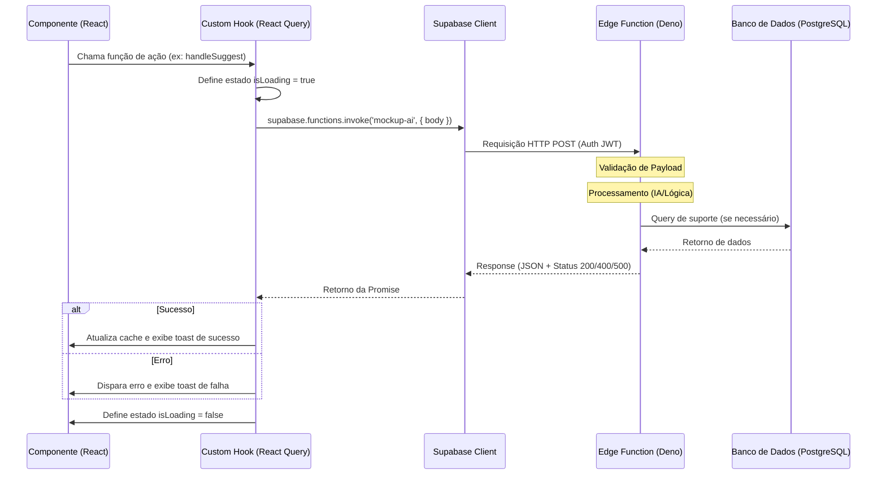

# Guia de Arquitetura - Freight Quest

Este documento descreve a arquitetura técnica, o fluxo de dados e os contratos de integração do projeto Freight Quest.

## 1. Diagrama de Sequência: Fluxo de Dados (Frontend para Edge Function)

O diagrama abaixo ilustra como uma ação do usuário (ex: sugestão de IA ou processamento pesado) trafega do componente até a Edge Function e retorna para a interface.



---

## 2. Mapa do Projeto e Responsabilidades

A estrutura do projeto segue um padrão de **Feature-based Architecture**, facilitando a escalabilidade.

### Estrutura de Pastas

- `src/features/`: Módulos independentes por domínio de negócio.
  - `[feature-name]/components/`: Componentes específicos da feature.
  - `[feature-name]/hooks/`: Lógica de estado e chamadas à API (React Query).
  - `[feature-name]/pages/`: Telas principais da feature.
  - `[feature-name]/lib/`: Utilitários puros da feature.
- `src/components/ui/`: Biblioteca de componentes base (Shadcn/UI).
- `src/hooks/`: Hooks globais (Auth, Theme, Mobile detection).
- `src/integrations/`: Configurações de serviços externos (Supabase).
- `supabase/functions/`: Código das Edge Functions (Backend Serverless).

### Camadas de Responsabilidade

1.  **View (Componentes):** Preocupam-se apenas com a renderização e interação do usuário.
2.  **Controller (Hooks):** Gerenciam o estado local, cache do servidor (React Query) e efeitos colaterais.
3.  **Service (Supabase Client):** Interface de comunicação com o backend e persistência.
4.  **Backend (Edge Functions):** Lógica complexa que não deve rodar no cliente (segurança, IA, integrações pesadas).

---

## 3. Exemplos de Chamadas Reais

### Chamada de Busca (Query)

```typescript
const { data, isLoading } = useQuery({
  queryKey: ["catalog-products"],
  queryFn: async () => {
    const { data, error } = await supabase.from("catalog_products").select("*");
    if (error) throw error;
    return data;
  },
});
```

### Chamada de Ação (Mutation + Edge Function)

```typescript
const { mutateAsync } = useMutation({
  mutationFn: async (payload) => {
    const { data, error } = await supabase.functions.invoke("mockup-ai", {
      body: { action: "suggest-placement", ...payload },
    });
    if (error) throw error;
    return data;
  },
});
```

---

## 4. Contrato da Edge Function: `external-db-bridge`

Esta função atua como um middleware de segurança e padronização para comunicação com sistemas externos (ERP/DB legados).

### Formato de Requisição (Request)

- **Método:** `POST`
- **Headers:** `Authorization: Bearer <JWT>`, `Content-Type: application/json`
- **Payload:**

```json
{
  "action": "sync_order" | "fetch_inventory" | "update_status",
  "table": "orders" | "products" | "shipments",
  "params": {
    "id": "UUID",
    "filter": {},
    "data": {}
  }
}
```

### Formato de Resposta (Response)

- **Sucesso (200 OK):**

```json
{
  "success": true,
  "data": [],
  "metadata": { "execution_time_ms": 120 }
}
```

- **Erro (400/500):**

```json
{
  "success": false,
  "error": {
    "code": "INSUFFICIENT_PERMISSIONS" | "EXTERNAL_SERVICE_TIMEOUT" | "INVALID_PAYLOAD",
    "message": "Descrição amigável do erro"
  }
}
```

### Tabelas Suportadas

- `catalog_products`: Sincronização de catálogo com o dashboard.
- `service_orders`: Gestão de ordens de serviço e status de produção.
- `audit_logs`: Registro centralizado de eventos críticos para compliance.

---

## 5. Padrões Obrigatórios: `external-db-bridge`

Para garantir a consistência e segurança, todos os novos módulos que integrarem com sistemas externos devem seguir estas regras:

### Regras de Ouro

1. **Validação com Zod:** Toda entrada deve ser validada usando esquemas Zod discriminados pela `action`.
2. **Tratamento de Erros:** Nunca retorne erros crus do banco. Use o objeto de erro padronizado (ver seção 4).
3. **Logs com Request ID:** Todas as operações devem logar o `requestId` para rastreabilidade.
4. **Idempotência:** Ações de `sync_order` devem ser seguras para repetição (UPSERT).

### Exemplo de Request (Sync Order)

```json
{
  "action": "sync_order",
  "table": "service_orders",
  "params": {
    "data": {
      "os_number": "OS-2024-001",
      "client_name": "ACME Corp",
      "status": "aberta"
    }
  }
}
```

### Exemplo de Response (Erro de Validação)

```json
{
  "success": false,
  "error": {
    "code": "INVALID_PAYLOAD",
    "message": "O campo 'os_number' é obrigatório e deve seguir o padrão OS-YYYY-NNN"
  }
}
```

## 6. Padrões de Tratamento de Erro

- **Frontend:** Uso de `ErrorBoundary` para falhas críticas de renderização e `Sonner/Toast` para falhas de mutação.
- **Backend:** Validação rigorosa de payload com Zod (ou similar) e logs estruturados em cada etapa do processamento na Edge Function.
